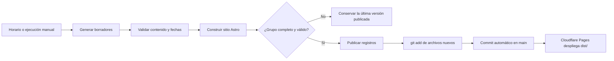

# Ranking Zodiacal

Sitio estático de entretenimiento con el horóscopo semanal, diario y mensual de los 12 signos. El ranking, los puntajes y los textos se calculan a partir de las posiciones reales del Sol, la Luna y los planetas, y se publican solos con GitHub Actions.

**Demo:** [horoscopo-semanal.pages.dev](https://horoscopo-semanal.pages.dev/)

[](https://github.com/jhony-vx/horoscopo-semanal/actions/workflows/publish-daily.yml)
[](https://github.com/jhony-vx/horoscopo-semanal/actions/workflows/publish-weekly.yml)
[](https://github.com/jhony-vx/horoscopo-semanal/actions/workflows/validate.yml)

> El contenido es de entretenimiento y no reemplaza asesoría médica, legal, financiera ni profesional.

## Inicio rápido

Requisitos: Node.js `22.12.0` o superior y npm.

```bash
npm install
npm run dev        # servidor de desarrollo en segundo plano
npm run test       # tests unitarios, astro check, build y E2E
```

## Qué ofrece

| Sección | Contenido |
| --- | --- |
| Portada | Ranking semanal del 1 al 12 con cuántos puestos subió o bajó cada signo, el cielo de hoy (fase lunar, retrógrados, próxima lunación), la lectura de la semana y una herramienta de compatibilidad entre dos signos. |
| Historial (`/semanas/`) | Una página por edición publicada con su ranking, su tendencia y el horóscopo semanal completo de cada signo. |
| Página de cada signo | Lectura de hoy, mañana, la semana y el mes; perfil con su constelación, mito, regente, modalidad y rasgos; compatibilidad y cómo le afecta la Luna de hoy. |
| Fondo | Rueda zodiacal propia en SVG con los nombres en español; gira despacio, reacciona al scroll y resalta el signo de cada página. |
| Preferencias | El signo elegido se guarda en `localStorage` y aparece en el menú y en la compatibilidad. |

También incluye compartir con Web Share API, navegación por teclado, soporte para movimiento reducido, transiciones nativas entre páginas, datos estructurados, tarjetas sociales por signo y sitemap.

## Tecnologías

| Tecnología | Uso |
| --- | --- |
| [Astro](https://astro.build/) 7 | Sitio estático, colecciones de contenido y fuentes optimizadas |
| [astronomy-engine](https://github.com/cosinekitty/astronomy) | Posiciones de los astros, fases lunares y lunaciones |
| [Motion](https://motion.dev/) (`motion/mini`) | Apariciones al hacer scroll, pestañas, modal y compatibilidad |
| [GSAP](https://gsap.com/) + ScrollTrigger | Entrada escalonada del ranking (se descarga solo en la portada) |
| TypeScript | Lógica del motor y scripts, ejecutados con `node --experimental-strip-types` |
| Playwright | Pruebas end-to-end y generación de tarjetas sociales |
| Pages CMS | Edición manual del contenido desde GitHub |
| Cloudflare Pages | Hosting, despliegues y previews |

## Estructura del proyecto

```text
src/
├── components/
│   ├── layout/      # Header, footer, fondo con la rueda, progreso de lectura
│   ├── ui/          # Piezas pequeñas: logo de signo, fase lunar, constelación
│   ├── shared/      # Usadas en varias páginas: grilla de signos, cielo de hoy
│   ├── home/        # Portada: hero, ranking, editorial, compatibilidad
│   └── sign/        # Página de signo: pestañas, perfil, compatibilidad, modal
├── content/         # Markdown publicado: weeks/, horoscopes/, forecasts/
├── layouts/         # Layout global con SEO y JSON-LD
├── lib/             # Consultas de contenido, ediciones y formato de fechas
├── pages/           # Rutas: portada, /horoscopo/[signo]/, /semanas/ y 404
├── scripts/         # Scripts de navegador: preferencias, reveal, compartir
├── styles/          # tokens.css (diseño) y base.css (estilos globales)
└── zodiac/          # Motor: signos, calendario, cielo, puntajes, textos, rueda, perfiles

scripts/             # Publicación, poda y tarjetas sociales
tests/               # Pruebas end-to-end
public/social/       # Tarjetas Open Graph generadas (1200 × 630)
```

## Comandos

| Comando | Qué hace |
| --- | --- |
| `npm run dev` | Levanta Astro en segundo plano (`astro dev stop` para detenerlo) |
| `npm run test:unit` | Tests de `src/**/*.test.ts` y `scripts/**/*.test.ts` |
| `npm run check` | Tipos y contenido con `astro check` |
| `npm run build` | Genera `dist/` |
| `npm run test:e2e` | Playwright en Chromium de escritorio y móvil |
| `npm run content -- <modo>` | Prepara o publica contenido (ver abajo) |
| `npm run content:prune` | Borra pronósticos diarios de más de 30 días |
| `npm run social:cards` | Regenera las tarjetas de `public/social/` y `apple-touch-icon.png` |

## Cómo se genera el contenido

El ranking, los puntajes y los textos salen de las posiciones astronómicas reales del Sol, la Luna, Mercurio, Venus, Marte, Júpiter y Saturno, calculadas al mediodía de Lima (`src/zodiac/`):

- `sky.ts`: signo de cada astro, retrógrados, fase lunar y lunaciones exactas.
- `scoring.ts`: compara cada astro con el signo del lector por distancia entre signos (conjunción, sextil, cuadratura, trígono, oposición) y pondera cada área con sus astros tradicionales. El ranking semanal promedia los siete días; en él, Júpiter y Saturno pesan un 25 % porque permanecen casi un año en cada signo y, si no, dominarían el puesto 1 durante meses.
- Regla editorial: ningún signo encabeza el ranking más de dos semanas seguidas. Si el cielo volviera a darle el puesto 1 a quien lo tuvo en las dos últimas semanas publicadas, sube el segundo.
- `texts.ts`: redacta cada sección con frases elegidas según el puntaje y nombra el tránsito que la explica. La elección es determinista: la misma fecha produce el mismo texto, y dos días seguidos se leen distinto.
- `profiles.ts`, `compatibility.ts` y `sky-summary.ts`: perfil de cada signo, compatibilidad por distancia en la rueda y el resumen del cielo que muestra el sitio.

Los workflows usan un solo script:

```bash
npm run content -- <prepare-day|publish-day|prepare-week|publish-week|prepare-month|publish-month> [--date=AAAA-MM-DD]
```

`prepare-*` crea solo los borradores que faltan (nunca sobrescribe) y `publish-*` valida el grupo completo antes de publicarlo. `--date` permite recuperar un día, una semana o un mes que no se publicó.

Para regenerar semanas ya publicadas (por ejemplo, después de cambiar el modelo), borra sus archivos en `weeks/` y `horoscopes/` y vuelve a prepararlas y publicarlas **de la más antigua a la más reciente**: la regla de las dos semanas seguidas se calcula con las ediciones anteriores publicadas.

## Diseño y animaciones

| Capa | Herramienta | Por qué |
| --- | --- | --- |
| Giro de la rueda y entrada del hero | CSS `@keyframes` | Corre desde el primer pintado, sin esperar JavaScript |
| La rueda y la barra de lectura con el scroll | CSS `animation-timeline: scroll()` | Va en el compositor; sin soporte, simplemente no se mueve |
| Secciones, pestañas, modal y compatibilidad | Motion mini (WAAPI) | 3 KB comprimidos y animaciones interrumpibles |
| Entrada del ranking | GSAP ScrollTrigger | Se importa bajo demanda cuando el ranking se acerca |
| Cambio de página | View Transitions entre documentos | El símbolo del signo viaja de la tarjeta a su página |

Reglas que conviene respetar:

- El contenido nunca se oculta con CSS: el JavaScript solo prepara lo que está debajo del pliegue, así el sitio se lee sin scripts.
- Con `prefers-reduced-motion: reduce` se desactiva todo movimiento.
- Los colores viven en `src/styles/tokens.css`; el acento de cada signo, en `src/zodiac/signs.ts`.
- `animation-timeline` va en una regla aparte del shorthand `animation`: el minificador los fusiona y Chrome descarta la declaración.

## Gestión del contenido

El contenido editorial se organiza en tres colecciones:

- `src/content/weeks/`: edición semanal, fechas, título, tema e introducción.
- `src/content/horoscopes/`: ranking, resumen, métricas y lectura completa de cada signo.
- `src/content/forecasts/`: pronósticos para hoy, mañana y este mes.

Los registros pueden estar en estado `draft` o `published`. Los borradores no se muestran en la web pública. Las validaciones comprueban fechas, puntuaciones de 1 a 5 y la integridad de los 12 signos antes de generar el sitio.

La edición manual se realiza con [Pages CMS](https://pagescms.org/) mediante la configuración de [`.pages.yml`](.pages.yml). Cada cambio aprobado genera un commit en GitHub y puede activar un nuevo despliegue.

## Automatización editorial

Las horas están expresadas en `America/Lima`; GitHub ejecuta los cron en UTC.

| Workflow | Programación | Contenido |
| --- | --- | --- |
| `publish-daily.yml` | Todos los días, 5:00 a. m. | Hoy y mañana para los 12 signos; poda los diarios de más de 30 días |
| `publish-weekly.yml` | Lunes, 5:00 a. m. | Ranking y lectura semanal |
| `publish-monthly.yml` | Día 1 de cada mes, 5:00 a. m. | Pronósticos mensuales |
| `validate.yml` | Cada push y pull request | Tests unitarios, type check, build y pruebas E2E |



Cada workflow editorial valida antes y después de publicar. Si falla una validación, no hace commit y la web mantiene la última edición válida. Los workflows editoriales no instalan Chromium ni repiten Playwright, para que una incidencia de infraestructura de pruebas no bloquee la actualización del contenido.

El workflow diario también se inicia cuando cambia `main`, para que una corrección pueda recuperar una publicación pendiente. Como cada publicación diaria redespliega el sitio, el cielo de hoy y las descripciones de cada signo se actualizan solos.

### Publicación manual de emergencia

1. Abre la pestaña **Actions** del repositorio.
2. Selecciona `Publish daily zodiac forecasts`, `Publish weekly zodiac ranking` o `Publish monthly zodiac forecasts`.
3. Pulsa **Run workflow** y confirma la rama `main`.
4. Revisa el commit automático y el nuevo despliegue de Cloudflare Pages.

## Despliegue

El sitio se despliega en Cloudflare Pages desde `main`:

```text
Build command: npm run build
Output directory: dist
Production branch: main
Node.js: 22.12.0
```

Cada push a `main` genera un despliegue de producción, y cada pull request, un preview.

## Contribuir

- Commits convencionales con descripción corta en español: `feat: agrega la compatibilidad entre signos`.
- Una rama y un pull request por cambio, con la descripción en español.
- Antes de abrir el PR: `npm run test`.

## Licencia

Proyecto personal de portafolio. El código y el contenido pertenecen a su autor. Si deseas reutilizar alguna parte, consulta primero las condiciones de uso.
